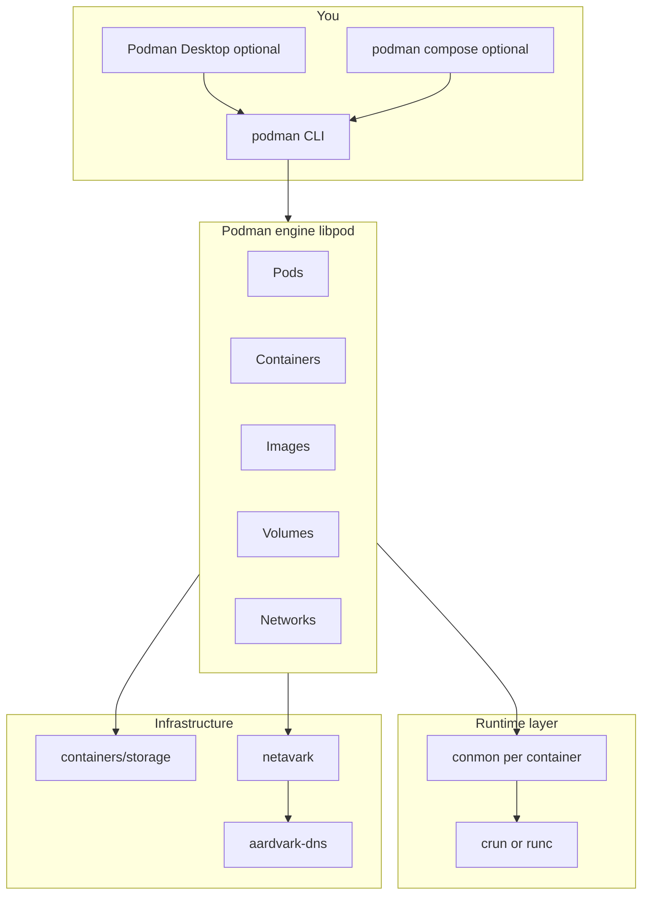

# Podman components and architecture

A map of what exists in and around Podman: resources you manage, tools in the ecosystem, runtime pieces, platform layers, and configuration.

See also: [PODMAN_SETUP.md](../PODMAN_SETUP.md) for installation and day-one commands.

---

## Big picture

Podman is the **CLI and engine** for OCI containers. Unlike Docker’s classic model, there is **no long-running central daemon** (`dockerd`) on Linux. When you run a container, the Podman process (often as your user) coordinates **storage**, **networking**, a per-container helper (**conmon**), and an **OCI runtime** (`crun` or `runc`).

On **macOS and Windows**, a **Podman Machine** (Linux VM) runs the engine; the CLI on your host talks to that VM.

---

## Core object types

Resources the CLI creates and manages (similar names to Docker, same OCI ideas):

| Component | What it is |
|-----------|------------|
| **Image** | Read-only template: layers + metadata. Built locally or pulled from a registry. |
| **Container** | An instance of an image plus runtime config (env, mounts, command, ports). |
| **Pod** | A group of containers that share a **network namespace** (and optionally other namespaces). Roughly a single-host Kubernetes pod. |
| **Volume** | Named persistent storage managed by Podman. |
| **Network** | Virtual network; attached containers/pods get connectivity and name resolution. |
| **Secret** | Runtime secret data (e.g. password file), not baked into the image. |
| **Manifest / image index** | Multi-arch or multi-image references (advanced pull/push). |

Learning notes (one file per type): [notes/core-object-types.md](../notes/core-object-types.md) → [notes/objects/](../notes/objects/).

---

## The `podman` CLI (command families)

| Area | Examples | Role |
|------|----------|------|
| Run lifecycle | `run`, `start`, `stop`, `restart`, `rm`, `pause` | Create and control containers |
| Inspect / logs | `ps`, `logs`, `inspect`, `top`, `stats`, `events` | Observability |
| Exec / attach | `exec`, `attach`, `cp` | Debug and file copy |
| Images | `pull`, `push`, `build`, `images`, `rmi`, `tag`, `load`, `save` | Image workflow |
| Pods | `pod create`, `pod ps`, `pod start`, `pod stop`, `pod rm` | Pod lifecycle |
| Volumes / networks | `volume *`, `network *` | Storage and connectivity |
| System | `info`, `version`, `system prune`, `system connection` | Health and cleanup |
| Machine (Mac/Win) | `machine init`, `machine start`, `machine stop`, `machine ssh` | Local Linux VM |
| Kubernetes bridge | `kube play`, `generate kube` | Apply or export YAML |
| Compose | `compose up`, `compose down`, `compose build` | Multi-service stacks (Compose spec) |

Learning notes (one file per family): [notes/podman-cli.md](../notes/podman-cli.md) → [notes/cli/](../notes/cli/).

### Optional REST API

On Linux you can enable a **Podman socket** for a Docker-compatible HTTP API so third-party tools that expect a daemon can talk to Podman. This is optional; normal CLI use does not require it.

---

## Sister tools (containers ecosystem)

Podman is the center of a larger stack. Responsibilities are split across tools:

| Tool | Purpose |
|------|---------|
| **Podman** | Run and manage containers, pods, networks, volumes; pull/push/build via integrated commands. |
| **Buildah** | Build OCI images from a Containerfile/Dockerfile. `podman build` uses Buildah under the hood. |
| **Skopeo** | Copy, inspect, delete, and sign images **without** running a workload container—registry ↔ registry, registry ↔ local storage. |
| **`podman compose`** | Official Compose integration: Podman as the backend (not a separate compose daemon). |
| **podman-compose** | Separate **Python** third-party project; not the same as `podman compose`. Prefer `podman compose` unless you have a specific reason otherwise. |

**Mnemonic:** **Podman** = run, **Buildah** = build, **Skopeo** = move/inspect images.

Learning notes (one file per tool): [notes/sister-tools.md](../notes/sister-tools.md) → [notes/sister-tools/](../notes/sister-tools/).

---

## Low-level runtime and infrastructure

You rarely call these directly; they explain logs, networking, and storage paths.

| Component | Role |
|-----------|------|
| **OCI runtime** (`crun` or `runc`) | Creates namespaces and cgroups, starts the container process from an OCI bundle. |
| **conmon** | Short-lived **container monitor** per container: exit status, logging pipes, etc. |
| **netavark** | Creates and manages container networks (common default on modern installs). |
| **aardvark-dns** | DNS for container names on netavark-managed networks. |
| **CNI plugins** | Older or alternate networking path; still appears in docs and some environments. |
| **containers/storage** | Image layers and container writable layers on disk (graph driver, store paths). |
| **containers/image** | Pull/push transports (`docker://`, `oci:`, dir, etc.). |

Learning notes: [notes/runtime.md](../notes/runtime.md) → [notes/runtime/](../notes/runtime/) (includes rootless vs rootful).

### Rootless vs rootful

Same components; different **identity and permissions**:

- **Rootless:** containers run as your user; **subuid/subgid** map UIDs inside the container.
- **Rootful:** run as root on the host (sometimes used on Mac/Windows machine via `podman machine set --rootful`).

On Linux, rootless is the recommended default for development. On Mac, the engine runs inside the **machine VM**; rootless vs rootful is configured there.

---

## Platform-specific components

| Platform | Component | Role |
|----------|-----------|------|
| macOS / Windows | **Podman Machine** | Lightweight Linux VM (e.g. Fedora) where the engine runs. |
| macOS / Windows | **Native CLI** | Commands on the host; execution happens in the machine. |
| All (optional) | **Podman Desktop** | GUI: images, containers, pods, volumes, machine resources, extensions. |

Typical Mac workflow: `podman machine start` → `podman run …`.

Learning notes: [notes/platform.md](../notes/platform.md) → [notes/platform/](../notes/platform/).

---

## Configuration and policy

Behavior is controlled by files under **`/etc/containers/`** (system) and **`~/.config/containers/`** (user). Inside a Mac/Windows machine, paths are on the Linux guest.

| File / concept | What it controls |
|----------------|------------------|
| **containers.conf** | Engine defaults: runtime choice, cgroup mode, other global options. |
| **storage.conf** | Where image/container data lives, storage driver options. |
| **registries.conf** | Short image names → registries; mirrors; insecure registries. |
| **policy.json** | Image signature verification policy. |
| **auth.json** | Credentials from `podman login`. |

When pulls, storage paths, or defaults surprise you, check `podman info` and these configs inside the machine (Mac) or on the host (Linux).

Learning notes: [notes/config.md](../notes/config.md) → [notes/config/](../notes/config/).

---

## Deployment and ops extras (optional)

| Feature | What it does |
|---------|----------------|
| **Quadlet** | Unit files for **systemd** that define containers/pods as services (Linux servers). |
| **podman auto-update** | With labels, periodically pull a newer image and recreate the container. |
| **Healthchecks** | Defined in image or Compose; Podman runs them similarly to Docker. |
| **OCI hooks** | Extra steps at defined points in container lifecycle. |

Useful after CLI basics when you want “always on” services on Linux.

---

## Podman vs Docker (component mapping)

| Docker | Podman |
|--------|--------|
| `dockerd` daemon | No central daemon on Linux; CLI drives the engine |
| Docker CLI | `podman` (optional `docker` alias) |
| Docker Compose | `podman compose` |
| `docker build` | `podman build` (Buildah) |
| Docker Desktop | Podman Desktop + Podman Machine (Mac/Win) |
| Docker Swarm | Not in Podman; use Compose, pods, or Kubernetes |
| Kubernetes | Pods plus `generate kube` / `kube play` (bridge, not a full cluster) |

---

## Learning notes: which component did I touch?

When writing a note in [`notes/`](../notes/), tag the area:

1. Machine (Mac/Windows)
2. Image / build (Buildah)
3. Container lifecycle + runtime (conmon, crun/runc)
4. Volume / bind mount + storage
5. Network + DNS (netavark, aardvark-dns)
6. Pod
7. Compose
8. Registry / login / push (Skopeo-style operations)
9. Socket / remote API (Docker compatibility)
10. Quadlet / systemd (Linux)

---

## Further reading

- [Official Podman documentation](https://docs.podman.io/)
- [Podman Desktop documentation](https://podman-desktop.io/docs)
- [Podman GitHub](https://github.com/containers/podman)
- [Docker to Podman tutorial](https://docs.podman.io/en/latest/Tutorials/docker_to_podman.html)
- [Buildah](https://github.com/containers/buildah)
- [Skopeo](https://github.com/containers/skopeo)
